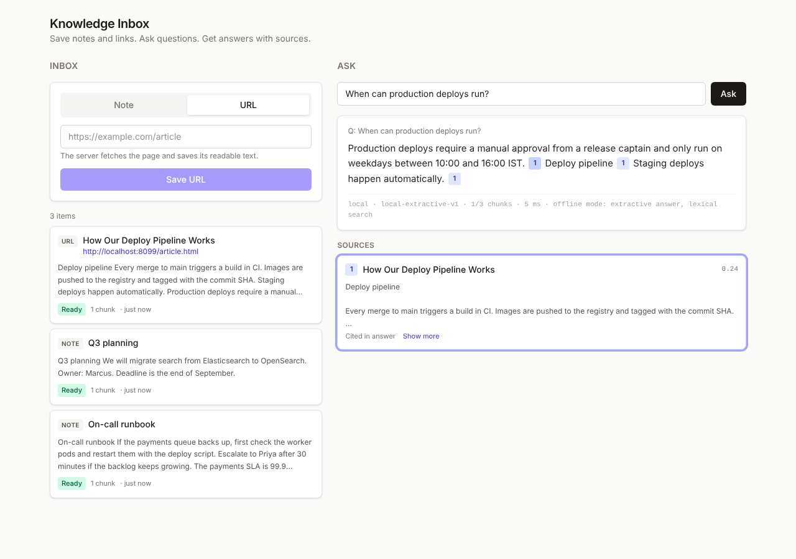

# AI Knowledge Inbox

Save short notes or URLs, then ask questions and get answers grounded in what you saved, with numbered citations back to the exact source snippets.

```
React (Vite)  ──/api──▶  Express  ──▶  SQLite (items, chunks + embeddings)
                            │              ▲
                            │       in-memory vector index (cosine)
                            └──▶  OpenAI-compatible API (embeddings + chat)
```

## Quick start

Requires Node 22.13+ (Node 24 recommended). No native modules: storage uses Node's built-in `node:sqlite`, so nothing needs compiling on Windows, macOS or Linux.

```bash
npm run install:all
cp server/.env.example server/.env    # optional: add OPENAI_API_KEY (Windows: copy)
npm run dev                           # dev: API on :3001, hot-reloading UI on http://localhost:5173
npm test                              # 37 API + unit tests, no network or key needed
npm start                             # production: builds the UI, serves app + API on http://localhost:3001
```



**Without an API key** the app runs in an offline mode: hashed bag-of-words embeddings (lexical, not semantic) and extractive answers (the best-matching sentences, cited). Every answer shows which mode produced it. This keeps the whole app demoable and the test suite hermetic. Set `OPENAI_API_KEY` for real semantic search and LLM answers; `OPENAI_BASE_URL` points it at any OpenAI-compatible server (Ollama, Azure, vLLM).

**Tested with Google Gemini (free tier)** through its OpenAI-compatible endpoint, with no code changes. See the commented block in `server/.env.example` (`gemini-embedding-001` + `gemini-2.5-flash`, `OPENAI_REASONING_EFFORT=none`). Two things that run surfaced, both now handled:
- **Thinking models spend output tokens before answering.** With a 600-token cap, answers were cut off mid-list. The output budget is now configurable (default 2000), thinking can be capped, and a truncated answer logs a warning.
- **Similarity scores aren't comparable across embedding models.** With Gemini, relevant chunks scored about 0.7–0.83 and unrelated ones about 0.47–0.55, so the `RETRIEVAL_MIN_SCORE` of 0.2 that suits the offline mode let noise through. 0.6 cleanly separates them. This is why the threshold is configuration, and why a small eval set (see production changes) is the right way to tune it.

## API

All endpoints are under `/api`. Errors always have one shape:

```json
{ "error": { "code": "VALIDATION_ERROR", "message": "Request body is invalid.",
             "details": [{ "field": "body.url", "message": "url must be a valid http(s) URL" }],
             "requestId": "8f1c…" } }
```

`code` is stable for clients to branch on, `details` appears only for validation errors, and `requestId` matches the `x-request-id` header and every server log line for that request.

### `POST /api/ingest` → `202 Accepted`

```json
{ "type": "note", "content": "Postgres backups run nightly at 02:00 UTC.", "title": "optional" }
{ "type": "url",  "url": "https://example.com/post", "title": "optional" }
```

Returns `{ item }` with `status: "pending"` and a `Location` header. Fetching the URL happens inside the request, so a bad URL fails fast with a specific message. Chunking and embedding happen in a background job; the item becomes `ready` or `failed` (with an `error` message).

| Status | Code | When |
|---|---|---|
| 400 | `VALIDATION_ERROR` / `INVALID_JSON` | Bad body: wrong `type`, empty content, non-http URL, unknown fields |
| 413 | `PAYLOAD_TOO_LARGE` | Body over 256 KB |
| 422 | `URL_FETCH_FAILED` | Unreachable, timed out, non-2xx, non-HTML/text, over 2 MB |
| 422 | `URL_NOT_ALLOWED` | Resolves to a private/loopback address (SSRF guard) |
| 422 | `EMPTY_CONTENT` | Page has no readable text (JS-only, login wall) |

### `GET /api/items?limit=50&offset=0` → `200`

`{ items, total, limit, offset }`, newest first. List entries carry a 280-char `preview` and `contentLength` instead of full content. `GET /api/items/:id` returns the full item; `DELETE /api/items/:id` returns `204`.

### `POST /api/query` → `200`

```json
{ "question": "When do backups run?", "topK": 5 }
```

```json
{
  "answer": "Backups run nightly at 02:00 UTC [1].",
  "sources": [{ "ref": 1, "itemId": "…", "chunkId": "…", "title": "DB ops", "sourceType": "note",
                "url": null, "snippet": "…", "score": 0.61, "cited": true }],
  "meta": { "provider": "openai", "chatModel": "…", "retrieved": 3, "indexedChunks": 42,
            "embedMs": 120, "searchMs": 1, "llmMs": 900, "totalMs": 1025, "usage": { … } }
}
```

`cited` tells the UI which retrieved chunks the answer actually used. If nothing clears the relevance threshold, the API says so and **skips the LLM call** rather than letting the model improvise. An AI provider failure returns `502 UPSTREAM_AI_ERROR`.

## Code layout

```
server/src
  app.js                 composition root: wires everything, nothing else knows the wiring
  config.js              all env parsing in one place
  http/                  routes, zod schemas, validate middleware, error handler
  services/              ingestService (two-phase ingest), queryService (retrieve → answer)
  rag/                   chunker, vectorStore, prompt building + citation parsing
  ai/                    provider contract + openai and offline implementations
  ingest/                urlFetcher (SSRF guard, size/time limits, readable-text extraction), jobQueue
  db/                    schema + repositories (all SQL lives here)
web/src
  api/client.js          fetch wrapper → typed ApiError with field errors and requestId
  hooks/                 useItems (list, polling while pending, optimistic delete), useAsk (abortable)
  components/            IngestForm, ItemList, AskPanel, AnswerView, SourceList, ErrorBanner, ErrorBoundary
```

Each layer depends only on the one below it, and every dependency is injected through `createApp`, which is why tests can swap in an in-memory DB and a stub or fake AI provider without mocks.

## Design decisions and tradeoffs

### Chunking

Structure-aware greedy packing: split into paragraphs, then sentences (only when a paragraph is too big), then words (only when a sentence is too big), and pack units up to **~800 characters** with **~150 characters of sentence-aligned overlap**.

- **Why ~800 chars (~200 tokens):** small enough that a chunk is about one thing, so its embedding is not diluted and retrieval is precise; large enough to make sense on its own when shown to the LLM and the user. Most notes fit in a single chunk, which is what you want for notes.
- **Why respect paragraphs and sentences:** fixed-size windows cut facts in half. Here no chunk starts or ends mid-sentence, and the splitter does not break on `99.9` or `v2.1`.
- **Why overlap:** a fact that straddles a boundary still appears whole in one chunk. Overlap is whole sentences, never fragments.
- **Contextual header:** the item's title is prepended to each chunk *before embedding* (not stored in the chunk). A chunk like "Escalate to Priya after 30 minutes" becomes findable by "on-call runbook".
- **Not done:** token-exact sizing (character counts are a good-enough proxy for English), semantic/heading-based splitting, parent-document retrieval. Those are the next steps if retrieval quality becomes the bottleneck.

### Vector store

Embeddings live in SQLite as `Float32` BLOBs next to their chunks, and are mirrored in an in-memory index searched by **exact brute-force cosine** (vectors are pre-normalised, so it is a dot product).

- One file, zero extra infrastructure, no native build step (Node's built-in SQLite), transactional with the items it belongs to: an item and its chunks can never drift apart, and a delete cascades.
- Exact search has perfect recall and is fast at this scale: 10k chunks × 1536 dims is about 15M multiply-adds, a few milliseconds.
- Each chunk records its `embedding_model`. Vectors from different models are never compared, and on startup any item without vectors for the current model is re-embedded automatically. Switching providers is safe.
- Writes go to disk first, then the cache, so a crash cannot leave the index ahead of the database.

### Async ingestion

Ingest is split into a fast synchronous phase (validate, fetch URL, persist raw content) and a background phase (chunk, embed, index). The user gets an immediate, specific error for the things they can fix (bad URL, 404) while slow or flaky embedding calls never hold a request open. The UI polls only while something is `pending`. Items left `pending` by a crash are re-queued at startup.

### Answer generation

The system prompt restricts the model to the numbered sources, requires `[n]` citations, tells it to say when the answer is not there, and marks source text as untrusted (basic prompt-injection hygiene, since saved web pages are attacker-controllable). Citations are parsed out of the answer and validated against the real source count, so the UI never links to a source that does not exist. Temperature is 0.1.

### URL fetching

The server fetches arbitrary user-supplied URLs, so it guards against SSRF: it resolves the hostname and refuses loopback, private, link-local (cloud metadata) and CGNAT ranges, and it re-checks on every redirect hop (redirects are followed manually, max 3). It also enforces a 10 s timeout, a 2 MB streaming size cap, and an HTML/plain-text content-type check. Readable text is extracted with cheerio: drop `script/style/nav/header/footer/aside`, prefer `<article>`/`<main>`, keep block structure as paragraph breaks for the chunker.

## What breaks at scale

| Area | Breaks when | Why |
|---|---|---|
| Vector search | ~100k+ chunks | Brute force is O(N·d) per query and the index lives in process memory (1536 floats ≈ 6 KB per chunk) |
| Startup | Large DB | Every embedding is loaded into memory at boot |
| Job queue | Process restart or multiple instances | In-process queue, no retries/backoff, no visibility; one process owns the index |
| SQLite | Concurrent writers across instances | Single writer; the in-memory index is not shared between processes |
| Embedding calls | Bulk imports | No batching across items, no rate-limit budget; a provider 429 storm fails items |
| URL fetching | JS-rendered pages, paywalls, PDFs | Plain HTTP fetch + HTML extraction only; DNS-rebinding gap between check and connect |
| Retrieval quality | Exact identifiers, acronyms, error codes | Pure dense retrieval misses exact-match terms; one fixed `minScore` doesn't fit every model |
| Context window | Large `topK` × long chunks | No token budgeting before the LLM call |
| Answer latency | Long answers | No streaming; the user waits for the full completion |

## What I'd change for production

1. **Vector store:** Postgres + pgvector (HNSW) so items, chunks and vectors share one transactional store with real concurrency; or sqlite-vec if it stays single-node. Same `vectorStore` interface, nothing else changes.
2. **Ingestion pipeline:** a durable queue (BullMQ/SQS) with retries, exponential backoff, a dead-letter queue and idempotency keys; batch embeddings across items; content-hash dedupe so re-saving a URL doesn't re-embed it.
3. **Retrieval quality:** hybrid search (BM25/FTS5 + dense, merged with reciprocal-rank fusion), a cross-encoder reranker over the top ~30, MMR to diversify sources, and a small labelled eval set (question → expected item) to tune chunk size, `topK` and `minScore` with numbers instead of intuition.
4. **Answers:** stream tokens over SSE; token-budget the context; structured output (JSON with answer + cited refs) instead of regex-parsing `[n]`; cache embeddings for repeated questions.
5. **URL fetching:** run through an egress proxy (fixes DNS rebinding), a headless browser for JS-rendered pages, a proper readability extractor, PDF support, robots.txt and per-domain rate limits.
6. **Multi-user:** auth, a `user_id` on every row and every vector query (tenant isolation enforced in the query, not the UI), per-user quotas and cost tracking.
7. **Operability:** OpenTelemetry traces across fetch → embed → search → LLM, metrics (ingest latency, failure rate, tokens, cost per query, retrieval scores), real migrations, request rate limiting, and serving the built frontend from the API or a CDN.

## Testing

`npm test` runs 37 tests (also in CI on every push via GitHub Actions) with Node's built-in runner against an in-memory database, fully offline:

- **Chunker:** size bounds, no mid-sentence cuts, sentence-aligned overlap, full coverage of the source, oversized sentences, decimals.
- **API:** every status code in the tables above, validation messages per field, pagination, delete removes from search, background indexing success and failure.
- **URL ingestion:** against a local HTTP server: redirect following, nav/script/footer stripping, 404 and wrong content type.
- **Production serving:** the built UI is served for app routes, while unknown `/api` routes still return JSON 404s.
- **OpenAI provider:** the real SDK pointed at a fake OpenAI-compatible server: checks the embeddings are reordered by index, the title header is embedded, the prompt contains numbered sources and grounding rules, citations come back, and an upstream 500 maps to `502`.
